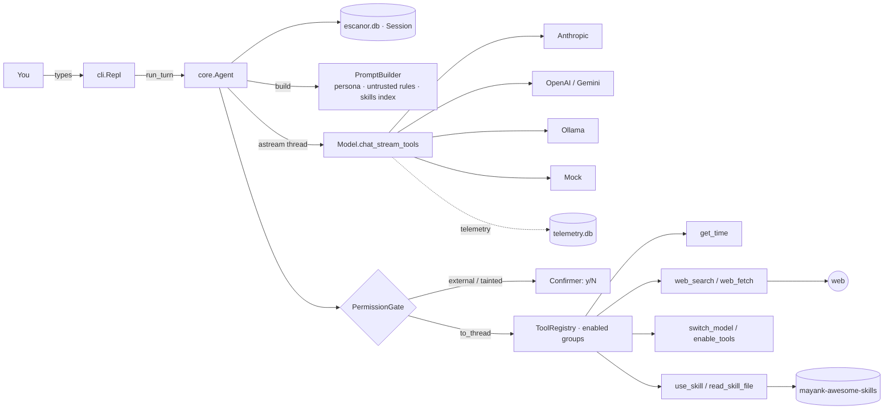
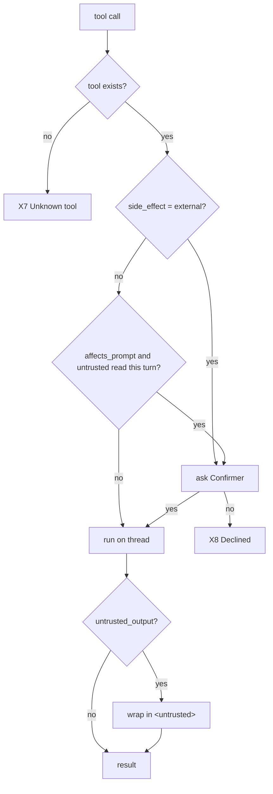

# Escanor core — Flow

How the core works at runtime: where execution starts, every function on the path, every way a
turn can end, and the low-level design underneath. Last synced: 2026-10-17, Phase 2 complete.

## 1. In one paragraph

You type a message in the terminal. The CLI hands it to the agent, which first tidies the
conversation (closing any tool call an interrupted turn left open, and rewriting other models' tool
turns as text if you switched models), saves your message, and sends the conversation to the
current model with the core tools: time, web search, web fetch, model switching, tool groups and
skills. The reply streams back and is printed as it arrives. If the model asks for a tool, the
permission gate decides whether it runs straight away, needs your "y" first, or is refused; web
content is fenced as untrusted before the model sees it. The result is saved and the model is asked
again, up to 8 times. The turn ends when the model answers without a tool, something fails, or you
press Ctrl-C. A model switch you ask for in words takes effect when the turn ends.

## 2. Big picture

## 3. Entrypoints

| # | Trigger | Entrypoint | Guard | Notes |
|---|---|---|---|---|
| E1 | `escanor` / `python -m escanor` | [cli.main](../../escanor/cli.py#L236) → [app.build_agent](../../escanor/app.py#L32) | default model must build (key present) | `--model`, `--continue` |
| E2 | A line typed at `you ›` | [Repl._loop](../../escanor/cli.py#L218) → [run_turn_interruptible](../../escanor/cli.py#L192) | — | `/commands` go to [handle_command](../../escanor/cli.py#L130) |
| E3 | `/model <name>` | [handle_command](../../escanor/cli.py#L130) → [Agent.set_model](../../escanor/core/agent.py#L115) | name must resolve and build | history fixed up on next turn |
| E4 | "switch to sonnet" (in words) | `switch_model` tool → [Agent.request_model_switch](../../escanor/core/agent.py#L121) | name must resolve and build | applied when the turn ends ([D13](decision.md#d13-switch_model-takes-effect-after-the-current-turn)) |
| E5 | Ctrl-C during a reply | SIGINT → `task.cancel()` | only while a turn runs | at the prompt, Ctrl-C exits |
| E6 | `/new`, `/skills`, `/tools`, `/models` | [handle_command](../../escanor/cli.py#L130) | — | `/new` also turns extra tool groups off |

## 4. Call chain (happy path)

### E2 — One turn with a tool

1. [Repl.run_turn_interruptible](../../escanor/cli.py#L192): runs the turn as a task; SIGINT cancels it
   1. [Agent.run_turn](../../escanor/core/agent.py#L137): wraps `_steps`; applies a pending model switch in `finally`
      1. [Session.repair](../../escanor/core/session.py#L155): **writes** a "cancelled" result for any unanswered tool call
      2. [Session.collapse_tool_history](../../escanor/core/session.py#L160): **rewrites** other models' tool turns (only after a switch)
      3. [Session.append_user](../../escanor/core/session.py#L131): **writes** your message
      4. loop up to `max_steps`:
         1. [PromptBuilder.build](../../escanor/core/prompts.py): persona + date + untrusted rules + skills index, then history
         2. [astream](../../escanor/core/agent.py#L60)(`model.chat_stream_tools`, enabled tool schemas): **calls** the provider on a worker thread; yields `TextDelta`s
         3. [Session.append_assistant](../../escanor/core/session.py#L137): **writes** text, tool calls, raw blocks, model spec
         4. no tool calls → `TurnDone` (X1)
         5. per tool call: `ToolStarted` →
            1. [PermissionGate.dispatch](../../escanor/tools/permissions.py#L46)
               1. [needs_confirmation](../../escanor/tools/permissions.py#L60): `external` → ask; `affects_prompt` + [turn_read_untrusted](../../escanor/tools/permissions.py#L66) → ask
               2. [TerminalConfirmer.confirm](../../escanor/cli.py#L107): `Allow? … [y/N]` via [StdinLines](../../escanor/cli.py#L49)
               3. [ToolRegistry.dispatch](../../escanor/tools/registry.py#L61) on a thread: refuses tools in disabled groups
               4. [fence_untrusted](../../escanor/tools/permissions.py#L38) for `web_search` / `web_fetch` output
            2. [Session.append_tool_result](../../escanor/core/session.py#L143) → `ToolFinished`
      5. pending switch applied → `ModelSwitched`

### Tool internals

- [WebFetchTool.run](../../escanor/assistant/web.py#L188) → [fetch_text](../../escanor/assistant/web.py#L130) → [check_url](../../escanor/assistant/web.py#L49) (scheme, resolve, refuse non-global) → urllib with [_CheckingRedirects](../../escanor/assistant/web.py#L68) → HTML to text → page of 12k chars with a `start=` hint
- [UseSkillTool.run](../../escanor/skills/tools.py) → `Skill.body()` + file list; [ReadSkillFileTool](../../escanor/skills/tools.py) → [Skill.read](../../escanor/skills/loader.py#L45) (confined to the skill folder)

## 5. Exits

| # | Exit | Condition | Where | You see | State left behind |
|---|---|---|---|---|---|
| X1 | ✅ Answer | model replies without tools | [agent.py `_steps`](../../escanor/core/agent.py#L146) | the reply | messages saved |
| X2 | 🚫 Refusal | `stop_reason == "refusal"` | same | reply + "(the model declined…)" | its tool calls not run; repaired next turn |
| X3 | ❌ Provider failure | network, rate limit, bad key → `RuntimeError` | same | `[error] …` | your message saved; no assistant message |
| X4 | ❌ Cut off | `max_tokens` with a tool call | same | `[error] The reply was cut off…` | text saved, half-written calls dropped |
| X5 | ❌ Step limit | 8 tool rounds without an answer | same | `[error] Stopped after 8…` | every call has a result |
| X6 | ⏹️ Cancelled | Ctrl-C | [cli.py#L192](../../escanor/cli.py#L192) | `(stopped)` | maybe an unanswered call → repaired next turn ([B6](bugs.md)) |
| X7 | 🔧 Tool error | tool raises / unknown / bad args / group off | [registry.py#L61](../../escanor/tools/registry.py#L61) | `✗ …` dimmed | error result fed back; turn continues |
| X8 | 🙅 Declined | you answer anything but y/yes, or no confirmer | [permissions.py#L46](../../escanor/tools/permissions.py#L46) | `✗ The user declined…` | tool not run; model told not to retry |
| X9 | 🛡️ Blocked fetch | non-http(s), local/private address, or redirect to one | [web.py#L49](../../escanor/assistant/web.py#L49) | `✗ … not fetching it` | nothing fetched |
| X10 | 🔁 Model switched | `switch_model` ran this turn | [agent.py#L137](../../escanor/core/agent.py#L137) | `switched to …` | next turn uses the new model |

## 6. Low-level design

### Components

| Module | Responsibility | Depends on |
|---|---|---|
| [cli.py](../../escanor/cli.py) | REPL, `/commands`, Ctrl-C, async stdin, y/N confirmations | app, Agent, SessionStore |
| [app.py](../../escanor/app.py) | Builds model + agent + tools + prompt sections from settings | everything below |
| [core/agent.py](../../escanor/core/agent.py) | Turn loop, `astream`, Gate/Confirmer protocols, deferred switch | Model, ToolRegistry, Session |
| [core/session.py](../../escanor/core/session.py) | Conversation storage + invariants (repair, collapse) | SQLite |
| [tools/permissions.py](../../escanor/tools/permissions.py) | Confirm/refuse/fence per call | registry, session |
| [tools/registry.py](../../escanor/tools/registry.py) | Tool lookup, groups, dispatch | tools |
| [tools/system_tools.py](../../escanor/tools/system_tools.py) | `get_time`, `enable_tools`, `switch_model` | registry, agent |
| [assistant/web.py](../../escanor/assistant/web.py) | `web_search`, `web_fetch` (+ address checks) | urllib, DuckDuckGo |
| [skills/](../../escanor/skills/) | SKILL.md discovery, index section, `use_skill`, `read_skill_file` | filesystem |
| [models/](../../escanor/models/) | Provider-neutral `Model` + four providers + mock | SDKs / urllib |

### Tool catalogue (Phase 2)

| Tool | Group | side_effect | untrusted_output |
|---|---|---|---|
| `get_time` | core | read | no |
| `web_search` | core | read | **yes** |
| `web_fetch` | core | read | **yes** |
| `switch_model` | core | write | no |
| `enable_tools` | core | read | no |
| `use_skill`, `read_skill_file` | core | read | no (your own files) |

### Permission decision

### Data model

| Store | Table | Field | Notes |
|---|---|---|---|
| `~/.escanor/escanor.db` | `conversations` | `id, title, created_at` | title = first 60 chars of first message |
| | `messages` | `conversation_id, body (JSON), created_at` | body = one message dict ([D10](decision.md#d10-store-each-message-as-one-json-body-in-sqlite)) |
| `~/.escanor/telemetry.db` | `calls` | one row per model call | copied from kmare-code ([B9](bugs.md)) |

### Config & flags

| Key | Default | Effect |
|---|---|---|
| `[models] default` | `haiku` | model at startup |
| `[models] effort` | `low` | Claude effort ([D7](decision.md#d7-default-claude-effort-low)) |
| `[models.aliases]` | haiku, sonnet, gpt, gemini, local, mock | `/model` and `switch_model` names |
| `[agent] max_steps` | `8` | tool rounds per turn (X5) |
| `[skills] dirs` | `~/.escanor/skills`, `~/projects/mayank-awesome-skills` | where SKILL.md folders are found |
| `[skills] allow` | `learn-anything`, `grill-me` | which skills are offered |
| `[web] allow_private_hosts` | `false` | X9 off when true ([D12](decision.md#d12-web_fetch-refuses-local-and-private-addresses-re-checked-on-every-redirect)) |
| `ESCANOR_HOME` | `~/.escanor` | data directory |
