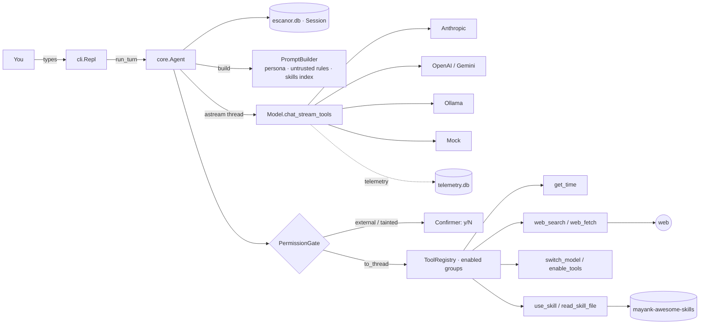
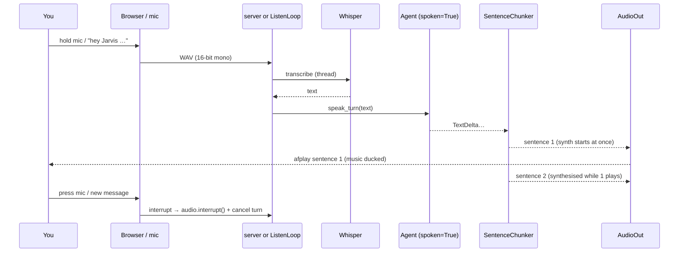
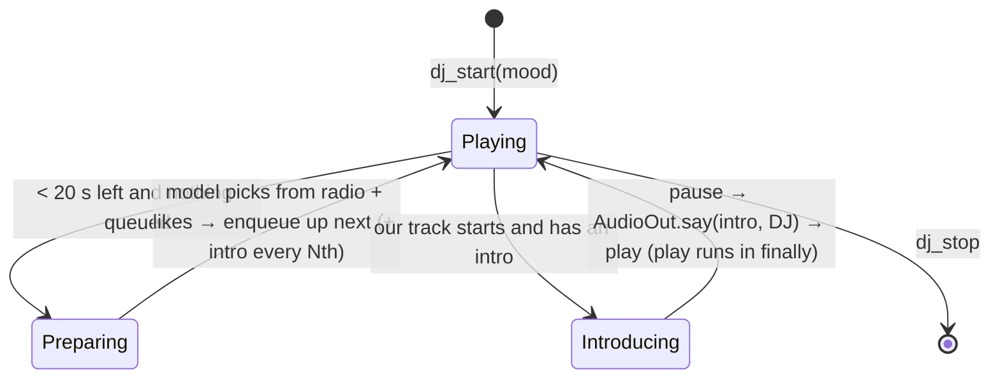
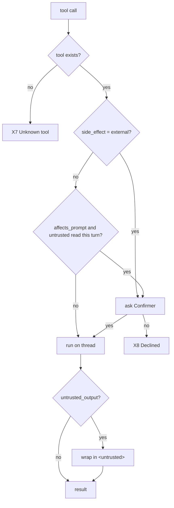

# Escanor core — Flow

How the core works at runtime: where execution starts, every function on the path, every way a
turn can end, and the low-level design underneath. Last synced: 2026-10-17, Phase 8 complete (final pass).

## 1. In one paragraph

You type a message in the terminal. The CLI hands it to the agent, which first tidies the
conversation (closing any tool call an interrupted turn left open, and rewriting other models' tool
turns as text if you switched models), saves your message, and sends the conversation to the
current model with the core tools: time, web search, web fetch, model switching, tool groups and
skills. The reply streams back and is printed as it arrives. If the model asks for a tool, the
permission gate decides whether it runs straight away, needs your "y" first, or is refused; web
content is fenced as untrusted before the model sees it. The result is saved and the model is asked
again, up to 8 times. The turn ends when the model answers without a tool, something fails, or you
press Ctrl-C. A model switch you ask for in words takes effect when the turn ends.

## 2. Big picture

## 3. Entrypoints

| # | Trigger | Entrypoint | Guard | Notes |
|---|---|---|---|---|
| E1 | `escanor` / `python -m escanor` | [cli.main](../../escanor/cli.py#L236) → [app.build_agent](../../escanor/app.py#L32) | default model must build (key present) | `--model`, `--continue` |
| E2 | A line typed at `you ›` | [Repl._loop](../../escanor/cli.py#L218) → [run_turn_interruptible](../../escanor/cli.py#L192) | — | `/commands` go to [handle_command](../../escanor/cli.py#L130) |
| E3 | `/model <name>` | [handle_command](../../escanor/cli.py#L130) → [Agent.set_model](../../escanor/core/agent.py#L115) | name must resolve and build | history fixed up on next turn |
| E4 | "switch to sonnet" (in words) | `switch_model` tool → [Agent.request_model_switch](../../escanor/core/agent.py#L121) | name must resolve and build | applied when the turn ends ([D13](decision.md#d13-switch_model-takes-effect-after-the-current-turn)) |
| E5 | Ctrl-C during a reply | SIGINT → `task.cancel()` | only while a turn runs | at the prompt, Ctrl-C exits |
| E7 | `escanor serve` → browser at :8770 | [voice/runtime.serve](../../escanor/voice/runtime.py) → [server/app.create_server](../../escanor/server/app.py) | binds 127.0.0.1 only | WebSocket per tab; push-to-talk, confirm dialog |
| E8 | `escanor listen` | [voice/runtime.listen](../../escanor/voice/runtime.py) → [ListenLoop](../../escanor/voice/listen.py) | mic permission | wake word (or Enter) → speak → answer aloud |
| E10 | `escanor music connect|status` | [cli.music_command](../../escanor/cli.py) | — | app token (click Allow) + optional ytmusicapi login |
| E11 | DJ background task | [DJ._loop](../../escanor/music/dj.py) every 2 s | started by `dj_start` | runs inside `serve` / `listen` / chat |
| E12 | `escanor brief` / "good morning" | `morning_briefing` tool → [Briefing.build](../../escanor/assistant/briefing.py) | — | calendar, reminders, timers, weather, journal |
| E13 | A timer fires | [TimerService._fire](../../escanor/assistant/timers.py) | — | notification + speech (TIMER priority) + CLI print |
| E14 | "explain this paper <link>" | `enable_tools(research)` → `research_ingest` → `use_skill(learn-anything)` → `research_read` parts | allowed folders for files (D36) | log saved to research/learn/ |
| E15 | `escanor usage` / `eval` / `service` / `brain backup` | [cli.main](../../escanor/cli.py) → [ops.py](../../escanor/ops.py), [costs.py](../../escanor/core/costs.py) | run by you | cost report, tool-choice eval, launchd, git backup |
| E9 | `escanor brain reindex|stats|backup` | [cli.main](../../escanor/cli.py) | — | maintenance |
| E6 | `/new`, `/skills`, `/tools`, `/models` | [handle_command](../../escanor/cli.py#L130) | — | `/new` also turns extra tool groups off |

## 4. Call chain (happy path)

### E2 — One turn with a tool

1. [Repl.run_turn_interruptible](../../escanor/cli.py#L192): runs the turn as a task; SIGINT cancels it
   1. [Agent.run_turn](../../escanor/core/agent.py#L137): wraps `_steps`; applies a pending model switch in `finally`
      1. [Session.repair](../../escanor/core/session.py#L155): **writes** a "cancelled" result for any unanswered tool call
      2. [Session.collapse_tool_history](../../escanor/core/session.py#L160): **rewrites** other models' tool turns (only after a switch)
      3. [Session.append_user](../../escanor/core/session.py#L131): **writes** your message
      4. loop up to `max_steps`:
         1. [PromptBuilder.build](../../escanor/core/prompts.py): persona + date + untrusted rules + brain guidance + facts.md + skills index, then history
         2. [astream](../../escanor/core/agent.py#L60)(`model.chat_stream_tools`, enabled tool schemas): **calls** the provider on a worker thread; yields `TextDelta`s
         3. [Session.append_assistant](../../escanor/core/session.py#L137): **writes** text, tool calls, raw blocks, model spec
         4. no tool calls → `TurnDone` (X1)
         5. per tool call: `ToolStarted` →
            1. [PermissionGate.dispatch](../../escanor/tools/permissions.py#L46)
               1. [needs_confirmation](../../escanor/tools/permissions.py#L60): `external` → ask; `affects_prompt` + [turn_read_untrusted](../../escanor/tools/permissions.py#L66) → ask
               2. [TerminalConfirmer.confirm](../../escanor/cli.py#L107): `Allow? … [y/N]` via [StdinLines](../../escanor/cli.py#L49)
               3. [ToolRegistry.dispatch](../../escanor/tools/registry.py#L61) on a thread: refuses tools in disabled groups
               4. [fence_untrusted](../../escanor/tools/permissions.py#L38) for `web_search` / `web_fetch` output
            2. [Session.append_tool_result](../../escanor/core/session.py#L143) → `ToolFinished`
      5. pending switch applied → `ModelSwitched`

### E7/E8 — A spoken turn

1. [server/app.py `conversation`](../../escanor/server/app.py): `audio` message → `speech.transcribe` on a thread → `{type: user}` → task `run(text, voice_input=True)`
   1. [speak_turn](../../escanor/voice/conversation.py): `agent.run_turn(spoken=True)` adds [VOICE_STYLE](../../escanor/core/prompts.py) to the system prompt
   2. each `TextDelta` → [SentenceChunker.feed](../../escanor/voice/chunker.py) → [AudioOut.say](../../escanor/voice/audio_out.py) (synthesis starts immediately, serialised by a lock)
   3. [AudioOut._run](../../escanor/voice/audio_out.py): highest priority first; ducks music; `afplay`; restores music when the queue drains (in `finally`)
2. Confirmations: [WebConfirmer](../../escanor/server/app.py) shows a dialog and says the question at `CONFIRM` priority; in `listen`, [VoiceConfirmer](../../escanor/voice/conversation.py) asks aloud and accepts only a clear yes ([is_yes](../../escanor/voice/conversation.py)).

### E11 — DJ mode

- [DJ.tick](../../escanor/music/dj.py): `player.song()` → new track? → `_on_new_track`; near the end → `_prepare_next`
- [_candidates](../../escanor/music/dj.py): [MusicLibrary.radio](../../escanor/music/library.py) + `liked()`, minus played
- [_choose](../../escanor/music/dj.py) / [_write_intro](../../escanor/music/dj.py): each a `SpendGuard.allow()`-gated model call
- Patter is `AudioOut` priority `DJ`: any reply or confirmation cuts it off; the music resumes regardless.
- While Escanor talks or listens, [PlayerDucker](../../escanor/music/player.py) lowers the app volume to `duck_level` and restores it.

### Escalation and budget inside a turn

1. [Agent._steps](../../escanor/core/agent.py): "think hard"? → [Router.escalation](../../escanor/core/router.py) → `ModelSwitched(sonnet)` for this turn
2. every step: `step == after_steps` and same provider → escalate mid-turn; then [DailyBudget.check](../../escanor/core/costs.py) (telemetry `usage_since(local midnight)` × prices) → over cap → `Error` (X13), no call made
3. [Agent.run_turn](../../escanor/core/agent.py) `finally`: back to the normal model (`ModelSwitched(haiku)`), then any requested `switch_model`

### Tool internals

- [WebFetchTool.run](../../escanor/assistant/web.py#L188) → [fetch_text](../../escanor/assistant/web.py#L130) → [check_url](../../escanor/assistant/web.py#L49) (scheme, resolve, refuse non-global) → urllib with [_CheckingRedirects](../../escanor/assistant/web.py#L68) → HTML to text → page of 12k chars with a `start=` hint
- [BrainSearchTool.run](../../escanor/brain/tools.py) → [BrainIndex.search](../../escanor/brain/index.py) → `sync()` (re-chunk changed files, embed missing chunks unless the embedder is backing off) → FTS5 bm25 top-20 + cosine top-20 → reciprocal-rank fusion → top 5
- [UseSkillTool.run](../../escanor/skills/tools.py) → `Skill.body()` + file list; [ReadSkillFileTool](../../escanor/skills/tools.py) → [Skill.read](../../escanor/skills/loader.py#L45) (confined to the skill folder)

## 5. Exits

| # | Exit | Condition | Where | You see | State left behind |
|---|---|---|---|---|---|
| X1 | ✅ Answer | model replies without tools | [agent.py `_steps`](../../escanor/core/agent.py#L146) | the reply | messages saved |
| X2 | 🚫 Refusal | `stop_reason == "refusal"` | same | reply + "(the model declined…)" | its tool calls not run; repaired next turn |
| X3 | ❌ Provider failure | network, rate limit, bad key → `RuntimeError` | same | `[error] …` | your message saved; no assistant message |
| X4 | ❌ Cut off | `max_tokens` with a tool call | same | `[error] The reply was cut off…` | text saved, half-written calls dropped |
| X5 | ❌ Step limit | 8 tool rounds without an answer | same | `[error] Stopped after 8…` | every call has a result |
| X6 | ⏹️ Cancelled | Ctrl-C | [cli.py#L192](../../escanor/cli.py#L192) | `(stopped)` | maybe an unanswered call → repaired next turn ([B6](bugs.md)) |
| X7 | 🔧 Tool error | tool raises / unknown / bad args / group off | [registry.py#L61](../../escanor/tools/registry.py#L61) | `✗ …` dimmed | error result fed back; turn continues |
| X8 | 🙅 Declined | you answer anything but y/yes, or no confirmer | [permissions.py#L46](../../escanor/tools/permissions.py#L46) | `✗ The user declined…` | tool not run; model told not to retry |
| X9 | 🛡️ Blocked fetch | non-http(s), local/private address, or redirect to one | [web.py#L49](../../escanor/assistant/web.py#L49) | `✗ … not fetching it` | nothing fetched |
| X11 | 🎙️ Nothing heard | voice message too short / empty transcript | [server/app.py](../../escanor/server/app.py), [listen.py](../../escanor/voice/listen.py) | "Didn't catch that" | no turn started |
| X12 | ✋ Interrupted | mic pressed / new message / barge-in (headphones) | [server/app.py `interrupt`](../../escanor/server/app.py) | speech stops, `done: interrupted` | session repaired next turn |
| X13 | 💸 Budget reached | today's spend ≥ `[budget] daily_usd` | [agent.py](../../escanor/core/agent.py) | `[error] Today's model budget…` | no model call made |
| X10 | 🔁 Model switched | `switch_model` ran this turn | [agent.py#L137](../../escanor/core/agent.py#L137) | `switched to …` | next turn uses the new model |

## 6. Low-level design

### Components

| Module | Responsibility | Depends on |
|---|---|---|
| [cli.py](../../escanor/cli.py) | REPL, `/commands`, Ctrl-C, async stdin, y/N confirmations | app, Agent, SessionStore |
| [app.py](../../escanor/app.py) | Builds model + agent + tools + prompt sections from settings | everything below |
| [core/agent.py](../../escanor/core/agent.py) | Turn loop, `astream`, Gate/Confirmer protocols, deferred switch | Model, ToolRegistry, Session |
| [core/session.py](../../escanor/core/session.py) | Conversation storage + invariants (repair, collapse) | SQLite |
| [tools/permissions.py](../../escanor/tools/permissions.py) | Confirm/refuse/fence per call | registry, session |
| [tools/registry.py](../../escanor/tools/registry.py) | Tool lookup, groups, dispatch | tools |
| [tools/system_tools.py](../../escanor/tools/system_tools.py) | `get_time`, `enable_tools`, `switch_model` | registry, agent |
| [assistant/web.py](../../escanor/assistant/web.py) | `web_search`, `web_fetch` (+ address checks) | urllib, DuckDuckGo |
| [skills/](../../escanor/skills/) | SKILL.md discovery, index section, `use_skill`, `read_skill_file` | filesystem |
| [brain/vault.py](../../escanor/brain/vault.py) | Markdown notes + facts.md, path confinement, backups | filesystem |
| [brain/index.py](../../escanor/brain/index.py) | Heading chunks, FTS5 + numpy cosine, RRF merge, incremental sync | SQLite, numpy, embedder |
| [brain/embeddings.py](../../escanor/brain/embeddings.py) | Ollama `nomic-embed-text`, hash, none | Ollama HTTP |
| [brain/tools.py](../../escanor/brain/tools.py) | The seven brain tools + brain guidance prompt | vault, index |
| [voice/stt, voice/tts, speech.py](../../escanor/voice/) | Whisper / Piper / Sarvam / mock engines (copied from kmare-voice) | faster-whisper, piper-tts |
| [voice/chunker.py](../../escanor/voice/chunker.py) | Fragments → speakable sentences | — |
| [voice/audio_out.py](../../escanor/voice/audio_out.py) | The only speaker owner: priority, pipelining, ducking, interrupt | afplay |
| [voice/conversation.py](../../escanor/voice/conversation.py) | `speak_turn`, `VoiceConfirmer` | agent, AudioOut |
| [voice/listen.py](../../escanor/voice/listen.py) | Wake word, energy VAD, utterance recording, `ListenLoop` | sounddevice, openWakeWord (optional) |
| [music/player.py](../../escanor/music/player.py) | YouTube Music app client (token, play, queue, volume) + `PlayerDucker` | th-ch API Server |
| [music/library.py](../../escanor/music/library.py) | search, radio, history, likes (cached 10 min) | ytmusicapi |
| [music/dj.py](../../escanor/music/dj.py) | DJ loop, picking, intros, `SpendGuard` | player, library, model, AudioOut |
| [music/tools.py](../../escanor/music/tools.py) | 7 music tools (group `music`) | the above |
| [assistant/osa.py](../../escanor/assistant/osa.py) | Safe AppleScript: quoting, locale-proof dates, permission errors | osascript |
| [assistant/apple.py](../../escanor/assistant/apple.py) | Reminders, Calendar, notify, open app/url, clipboard (9 tools, group `assistant`) | osa |
| [assistant/timers.py](../../escanor/assistant/timers.py) | Timers + announcers | asyncio |
| [assistant/briefing.py](../../escanor/assistant/briefing.py) | Morning briefing sources | apple, timers, vault, web |
| [research/ingest.py](../../escanor/research/ingest.py) | arXiv / link / local file → text → research/<slug>/source.md | web.py checks, pypdf |
| [research/reviews.py](../../escanor/research/reviews.py) | learn-anything logs → reviews due | vault |
| [research/tools.py](../../escanor/research/tools.py) | research_ingest, research_read, research_reviews (group `research`) | the above |
| [core/router.py](../../escanor/core/router.py) | When to hand a turn to the stronger model | models |
| [core/costs.py](../../escanor/core/costs.py) | Prices, cost of usage rows, `DailyBudget` | telemetry |
| [ops.py](../../escanor/ops.py) | launchd service, brain git backup, tool-choice eval | launchctl, git |
| [server/](../../escanor/server/) | FastAPI app, WebSocket protocol, static UI | fastapi, uvicorn[standard] |
| [models/](../../escanor/models/) | Provider-neutral `Model` + four providers + mock | SDKs / urllib |

### Tool catalogue

| Tool | Group | side_effect | untrusted_output |
|---|---|---|---|
| `brain_search` | core | read | no (attached folders fenced inside result, D18) |
| `brain_read` | core | read | no |
| `remember_fact` | core | write, **affects_prompt** | no |
| `brain_write`, `brain_append`, `brain_list` | brain | write / read | no |
| `forget_fact` | brain | write, **affects_prompt** | no |
| `get_time` | core | read | no |
| `web_search` | core | read | **yes** |
| `web_fetch` | core | read | **yes** |
| `switch_model` | core | write | no |
| `enable_tools` | core | read | no |
| `use_skill`, `read_skill_file` | core | read | no (your own files) |

### Permission decision

### Data model

| Store | Table | Field | Notes |
|---|---|---|---|
| `~/.escanor/escanor.db` | `conversations` | `id, title, created_at` | title = first 60 chars of first message |
| | `messages` | `conversation_id, body (JSON), created_at` | body = one message dict ([D10](decision.md#d10-store-each-message-as-one-json-body-in-sqlite)) |
| `~/.escanor/telemetry.db` | `calls` | one row per model call | copied from kmare-code ([B9](bugs.md)) |
| `~/.escanor/brain/` | `*.md` | your notes + `facts.md` | plain files, editable anywhere |
| `~/.escanor/brain-history/` | `<path>.<timestamp>.md` | previous versions | written before replace / forget (D17) |
| `~/.escanor/brain-index.db` | `files`, `chunks`, `chunks_fts` | mtime+hash per file; heading, text, vector per chunk | rebuilt from the notes at any time |

### Config & flags

| Key | Default | Effect |
|---|---|---|
| `[models] default` | `haiku` | model at startup |
| `[models] effort` | `low` | Claude effort ([D7](decision.md#d7-default-claude-effort-low)) |
| `[models.aliases]` | haiku, sonnet, gpt, gemini, local, mock | `/model` and `switch_model` names |
| `[agent] max_steps` | `8` | tool rounds per turn (X5) |
| `[skills] dirs` | `~/.escanor/skills`, `~/projects/mayank-awesome-skills` | where SKILL.md folders are found |
| `[skills] allow` | `learn-anything`, `grill-me` | which skills are offered |
| `[brain] embedder` | `ollama` | `ollama` / `hash` / `none`; falls back to keywords when Ollama is down |
| `[brain] extra_dirs` | `[]` | read-only folders to search (e.g. Obsidian) |
| `[web] allow_private_hosts` | `false` | X9 off when true ([D12](decision.md#d12-web_fetch-refuses-local-and-private-addresses-re-checked-on-every-redirect)) |
| `[voice] stt / whisper_model` | `faster-whisper` / `base` | speech-to-text |
| `[voice] tts / tts_voice` | `piper` / default `en_US-lessac-medium` | text-to-speech (reuses `~/.kmare/voices`) |
| `[voice] wake_word` | `hey_jarvis` | openWakeWord model |
| `[voice] barge_in` | `off` | `headphones` enables talking over Escanor in `listen` (D24) |
| `[music] enabled / api_url` | `true` / `http://127.0.0.1:26538` | YouTube Music app API Server plugin |
| `[music] dj_model / patter_every` | `haiku` / `2` | who picks and talks; intro every Nth track |
| `[music] daily_model_calls / duck_level` | `150` / `20` | DJ spend cap; music volume while talking |
| `[assistant] enabled / city` | `true` / `""` | Apple tools + timers + briefing; city for weather |
| `[research] allowed_dirs` | Downloads, Documents, Desktop | local files research_ingest may read |
| `[router] escalate_to / after_steps` | `sonnet` / `4` | escalation (D39); `""` = off |
| `[budget] daily_usd / prices` | `3.0` / `{}` | spend cap (D40) |
| `[server] host / port` | `127.0.0.1` / `8770` | web UI address (D26) |
| `ESCANOR_HOME` | `~/.escanor` | data directory |
