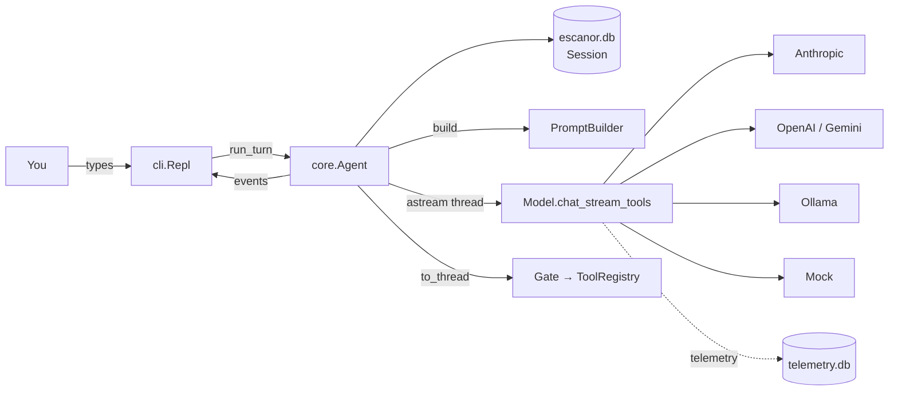
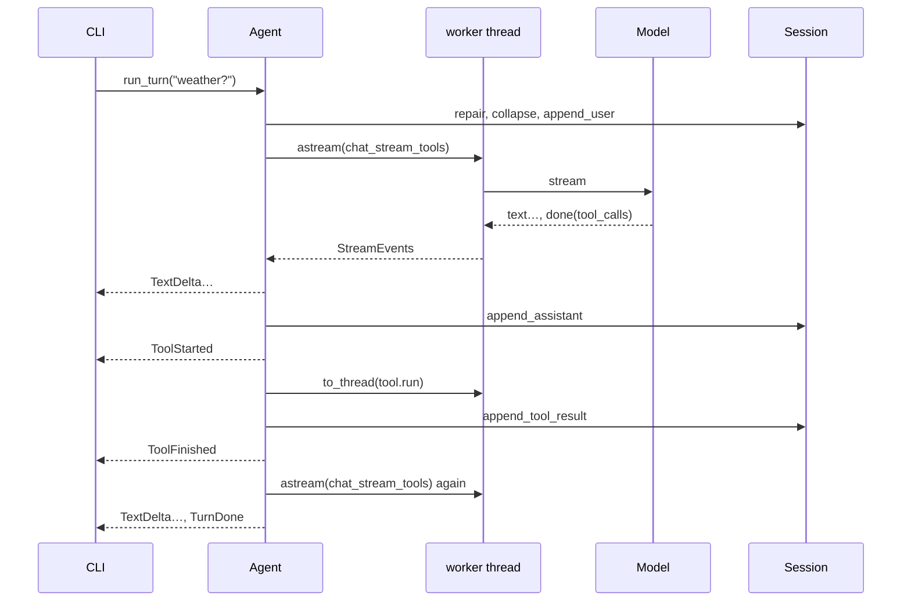

# Escanor core — Flow

How the core works at runtime: where execution starts, every function on the path, every way a
turn can end, and the low-level design underneath. Last synced: 2026-10-17, Phase 1 (step 5).

## 1. In one paragraph

You type a message in the terminal. The CLI hands it to the agent, which first tidies the
conversation (closing any tool call a previous interrupted turn left open, and rewriting other
models' tool turns as text if you switched models), saves your message, and sends the whole
conversation to the current model. The reply streams back word by word and is printed as it
arrives. If the model asks for a tool, the agent runs it on a background thread, saves the result,
and asks the model again, up to 8 times. The turn ends when the model answers without a tool, when
something fails, or when you press Ctrl-C. Every message is saved to SQLite as it happens.

## 2. Big picture



## 3. Entrypoints

| # | Trigger | Entrypoint | Guard | Notes |
|---|---|---|---|---|
| E1 | `escanor` / `python -m escanor` | [cli.main](../../escanor/cli.py#L153) | default model must build (key present) | `--model`, `--continue` |
| E2 | A line typed at `you ›` | [Repl.loop](../../escanor/cli.py#L134) → [Repl.run_turn_interruptible](../../escanor/cli.py#L116) | — | `/commands` go to [handle_command](../../escanor/cli.py#L67) |
| E3 | `/model <name>` | [Repl.handle_command](../../escanor/cli.py#L67) → [Agent.set_model](../../escanor/core/agent.py#L114) | name must resolve and build | history fixed up on next turn |
| E4 | Ctrl-C during a reply | SIGINT handler → `task.cancel()` | only while a turn runs | at the prompt, Ctrl-C exits |

## 4. Call chain (happy path)

### E2 — One turn

1. [Repl.run_turn_interruptible](../../escanor/cli.py#L116): runs the turn as a task; SIGINT cancels it
   1. [Agent.run_turn](../../escanor/core/agent.py#L123)
      1. [Session.repair](../../escanor/core/session.py#L155): **writes** a "cancelled" result for any unanswered tool call
      2. [Session.collapse_tool_history](../../escanor/core/session.py#L160): **rewrites** other models' tool turns as text (only after a switch)
      3. [Session.append_user](../../escanor/core/session.py#L131): **writes** the message; titles the conversation on first message
      4. loop up to `max_steps`:
         1. [PromptBuilder.build](../../escanor/core/prompts.py): system prompt + history
         2. [astream](../../escanor/core/agent.py#L60)(`model.chat_stream_tools`): **calls** the provider on a worker thread; yields `TextDelta`s
            - [InstrumentedModel.chat_stream_tools](../../escanor/models/instrumented.py): **writes** a telemetry span
            - e.g. [AnthropicModel.chat_stream_tools](../../escanor/models/anthropic_provider.py#L59): `messages.stream(...)`, final message → `ModelResponse` with `raw`
         3. [Session.append_assistant](../../escanor/core/session.py#L137): **writes** text, tool calls, raw, model spec
         4. no tool calls → yield `TurnDone` (X1)
         5. per tool call: yield `ToolStarted` → [Gate.dispatch](../../escanor/core/agent.py#L43) → [ToolRegistry.dispatch](../../escanor/tools/registry.py) on a thread → [Session.append_tool_result](../../escanor/core/session.py#L143) → yield `ToolFinished`
   2. the CLI prints each event as it arrives

## 5. Exits

| # | Exit | Condition | Where | You see | State left behind |
|---|---|---|---|---|---|
| X1 | ✅ Answer | model replies without tools | [agent.py `TurnDone`](../../escanor/core/agent.py#L123) | the reply | user + assistant (+ tool) messages saved |
| X2 | 🚫 Refusal | `stop_reason == "refusal"` | same | reply + "(the model declined…)" | tool calls in that reply not run; repaired next turn |
| X3 | ❌ Provider failure | network, rate limit, bad key → `RuntimeError` | [agent.py](../../escanor/core/agent.py#L123) `except RuntimeError` | `[error] …` | user message saved; no assistant message |
| X4 | ❌ Cut off | `max_tokens` with a tool call | same | `[error] The reply was cut off…` | text saved, half-written calls dropped |
| X5 | ❌ Step limit | 8 tool rounds without an answer | same | `[error] Stopped after 8…` | every call has a result |
| X6 | ⏹️ Cancelled | Ctrl-C | [cli.py#L116](../../escanor/cli.py#L116) | `(stopped)` | possibly an unanswered call → repaired next turn ([B6](bugs.md)) |
| X7 | 🔧 Tool error | tool raises / unknown tool / bad args | [registry.py](../../escanor/tools/registry.py) | `✗ …` dimmed | error result fed back to the model; turn continues |

## 6. Low-level design

### Components

| Module | Responsibility | Depends on |
|---|---|---|
| [cli.py](../../escanor/cli.py) | Terminal REPL, `/commands`, Ctrl-C, confirmation prompt | Agent, SessionStore, config |
| [core/agent.py](../../escanor/core/agent.py) | Turn loop, `astream` thread bridge, Gate/Confirmer protocols | Model, ToolRegistry, Session, PromptBuilder |
| [core/session.py](../../escanor/core/session.py) | Conversation storage + invariants (repair, collapse) | SQLite |
| [core/prompts.py](../../escanor/core/prompts.py) | System prompt from persona + pluggable sections | — |
| [core/events.py](../../escanor/core/events.py) | Event types every interface consumes | — |
| [models/](../../escanor/models/) | Provider-neutral `Model`; Anthropic, OpenAI(+Gemini), Ollama, Mock | SDKs / urllib |
| [config.py](../../escanor/config.py) | Keys from env/.env, `config.toml`, model aliases | — |

### Key signatures

```python
Model.chat_stream_tools(messages, tools=None) -> Iterator[StreamEvent]   # "text"* then one "done"
Agent.run_turn(session, user_text, confirmer=None) -> AsyncIterator[Event]
Gate.dispatch(call, tools, confirmer, session) -> Awaitable[ToolResult]
config.resolve_model("sonnet", settings) -> ("anthropic", "claude-sonnet-5-5")
```

### Sequence (one tool round)



### Data model

| Store | Table | Field | Notes |
|---|---|---|---|
| `~/.escanor/escanor.db` | `conversations` | `id, title, created_at` | title = first 60 chars of first message |
| | `messages` | `conversation_id, body (JSON), created_at` | body = one message dict ([D10](decision.md#d10-store-each-message-as-one-json-body-in-sqlite)) |
| `~/.escanor/telemetry.db` | `calls` | one row per model call | copied from kmare-code |

### Errors, retries, idempotency

- Provider errors become `RuntimeError` → exit X3. The Anthropic/OpenAI SDKs retry 429/5xx twice themselves.
- Tool errors never escape: they become an error `ToolResult` the model can react to (X7).
- Each message is committed on append, so a crash loses at most the in-flight reply.

### Config & flags

| Key | Default | Effect |
|---|---|---|
| `[models] default` | `haiku` | model at startup |
| `[models] effort` | `low` | Claude effort ([D7](decision.md#d7-default-claude-effort-low)) |
| `[models.aliases]` | haiku, sonnet, gpt, gemini, local, mock | `/model` names |
| `[agent] max_steps` | `8` | tool rounds per turn (X5) |
| `ESCANOR_HOME` | `~/.escanor` | data directory |
